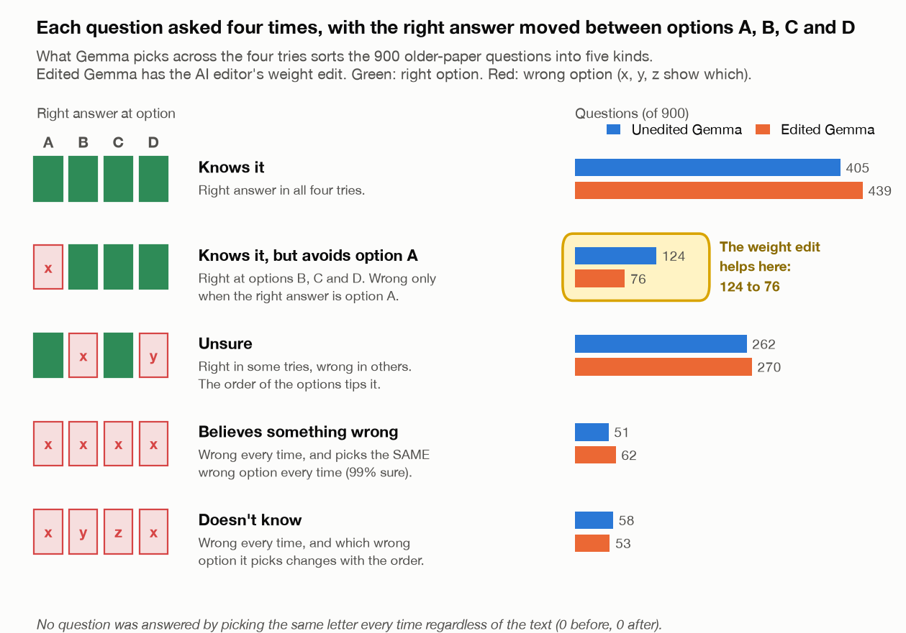

# Can a targeted weight edit improve a model's Swedish? A test on Gemma 3 4B

**Summary.** I tested whether small, targeted changes to a model's weights can make it better at Swedish, using Gemma 3 4B and Högskoleprovet, the Swedish university entrance exam. In my tests, they did not. A weight edit found by an AI agent reduced a real habit (Gemma avoids answer option A), and that fix survives compression to 4-bit. But I found no sign that any weight edit changed which answers Gemma can reach. Other research points to training instead, mainly distillation: training the Swedish model on a stronger model's outputs. I did not test training myself. **Full report with all figures, numbers and sources: [report/report.pdf](report/report.pdf).**

## 1. The article

In the blog post [*Sparks of Weight-Space Programming*](https://rikiyat.github.io/blog/weight-space-programming/) (Takehi et al., 2026), an AI agent called Astra changed 0.016% of the weights of a small model (Qwen3.5-0.8B). Its score on a maths test (MATH-500) rose from 7.9% to 48.1%, and an [independent re-run](https://huggingface.co/JonathanColetti/Qwen3.5-0.8B-Astra-WeightEdit) got the same result. But the edit fixed a behaviour, not maths ability. In its "thinking" mode the model got stuck repeating itself. With thinking switched off, the unedited model already solved 45.8%, and the edited model with thinking on was only 4.3 points better than that (re-run). The authors agree: *"Editing weights could remove an obstacle that hid an ability, but it could not add an ability the model lacked."* Reading weights alone worked on small networks, including three tiny language models, but failed when Astra had to tell which of two language models was sycophantic. The maths edit was found with the help of many runs of the model on practice problems. (Report, section 1.)

## 2. Hypothesis

**If I change Gemma's weights using its mistakes on the older exam papers, the edited model will do better on the newest, unseen exam papers, and the gain will survive compression.** I tried three ways to build such a weight edit: one edit per wrong question, one group edit, and AI editors. The AI editors were added after the first two. All three are judged by the same rule, fixed before any model was run ([`config/decision.toml`](config/decision.toml), committed to git about six hours before the first run. One later line limits the score to the reading and sentence-completion sections). It matters because a weight edit takes seconds, while training a model further on Swedish text takes thousands of GPU hours.

I test on the reading and sentence-completion sections of Högskoleprovet. Every question is multiple choice with four options. I judge weight edits on the three newest exam papers (2025–26, 120 questions), which came out after Gemma was trained. The hypothesis holds only if the edited model puts more probability on the right answers (with a 95% confidence interval above zero), does better than a random weight change of the same size, gets no worse at ordinary Swedish text, and keeps the gain after compression to 4-bit.

## 3. Experiment

I used two models, Qwen3.5-9B and Gemma 3 4B, each at full precision (16-bit) and compressed by me to 4-bit (Q4_K_M):

1. **Baselines:** the unedited models on 23 older exam papers (2013–2024) and the 3 test papers.
2. **One weight edit per wrong question,** on both models. Each weight edit was compared with a random weight change of the same size.
3. **Focus on Gemma:** it had more room to improve and lost more from compression.
4. **A group edit:** a small trained change (standard fine-tuning) using 205 questions Gemma got wrong.
5. **AI editors, copying the article's maths experiment:** like Astra, three Claude Opus 5.5 agents each got Gemma's weights and a budget of 10, 25 or 50 model runs (I call them the 10-run, 25-run and 50-run AI editor). They had to find a weight edit without training the model. They used only 5, 7 and 11 of their runs.
6. **Testing the best AI-editor weight edit:** each AI editor made and tested several weight edits, but all three chose to give no change as their final answer, because their weight edits fixed about as many questions as they broke. I scored the four weight edits they had saved on the unseen papers and picked the best, made by the 50-run AI editor (so its unseen-paper results are not fully independent). I then asked every question four times, moving every option one place each time, so the right answer was shown once as option A, B, C and D. This test was added after the AI editors found Gemma's habit (exploratory). I compared the weight edit with two fixes that change no weights: a prompt note telling Gemma to read every option carefully, and averaging Gemma's preference for each option over the four orders.
7. **Checks:** compression of the edited Gemma to 4-bit, two other tests (Belebele reading in Swedish and English, and MMLU maths), and nine independent AI agents re-checking about 120 of my numbers.

## 4. Results

Below, "fixed" means wrong before the weight edit and right after it. "Broken" means right before and wrong after.

- **No weight edit built on the older papers helped on the unseen papers.** One-question weight edits fixed only their own question: none of the 12 improved the test papers, and 9 made them clearly worse. The group edit fixed 5 and broke 4 unseen questions, which is within chance. The AI editors' weight edit (below) also failed my pre-set rule.
- **The AI editors found a habit: Gemma avoids option A.** When the right answer was option A, Gemma got 53.6% right. When it was option B, C or D, Gemma got 70.8–75.9% right. This is a known multiple-choice bias ([Zheng et al., ICLR 2024](https://arxiv.org/abs/2309.03882)). It also shows in English, but about twice as strongly in Swedish (31 against 15 questions on the same Belebele test).
- **How the weight edit works:** in layer 23, two attention heads look at each option and copy its letter as the answer, and they look less at option A. The weight edit makes option A easier for them to match, so they look at it more. It does not make Gemma judge the options better.
- **The best weight edit reduced this habit.** When the right answer was option A, it fixed 83 questions and broke none. It did the same on papers no edit was built on: 27 fixed and 0 broken on 8 held-out older papers, and 11 fixed and 0 broken on the test papers. A random weight change of the same size fixed 2. But the weight edit broke some answers at options B, C and D, so the score over all four positions rose by only 1 point. By the rule I fixed before any edit, this weight edit is also "no improvement" on the test papers.
- **It changed behaviour, not knowledge** (figure below). Gemma got 109 questions wrong in all four orders. After the weight edit, none of them was right in all four orders. 12 became right in some orders, but 18 others became wrong in all four, so this group grew to 115. When the right answer was option A and Edited Gemma was still wrong, it picked the same wrong option as before on 329 of 335 questions. Averaging over the four orders did as well as the weight edit on both unseen sets. The prompt note helped only on the test papers.
- **It survives compression** (measured the same exploratory way). Compression to 4-bit makes the habit worse: unedited Gemma's right answers at option A drop from 252 to 212 of 440 unseen questions. At 4-bit the weight edit still fixed 48 and broke none.
- **It did no harm to ordinary Swedish.** I measured this on 75 Swedish parliament (Riksdag) speeches from 2025–26, all newer than Gemma's training data. The weight edit changed Gemma's perplexity on them, a measure of how surprised the model is by the text, by +0.05% (my limit was +5%). My second check, for looping text, was too noisy to use. (Report, section 4.)

*How to read the figure: each question was asked four times, with the right answer at option A, B, C and D. The squares show what Gemma picked (green: right, red: wrong, letters: which wrong option). The bars count the 900 older-paper questions of each kind, before (blue) and after (orange) the weight edit. The "avoids option A" kind shrinks most. The two kinds Gemma always gets wrong do not shrink overall (109 before, 115 after).*

## 5. What I learned

The hypothesis was wrong. A weight edit can change a behaviour, but I found no sign that it changed which answers Gemma can reach. Other research shows the same split. A tiny edit to Gemma 7B's weights switched off its refusals without changing its knowledge score ([Arditi et al., 2024](https://arxiv.org/abs/2406.11717)). Edits to the parts of a model linked to a specific language did not improve its results on tasks in low-resource languages ([Mondal et al., 2025](https://aclanthology.org/2025.insights-1.6/)). **Changing Gemma's weights changed how it picks among answers it can already reach. I found no sign that it changed which answers Gemma can reach.** Most of Gemma's mistakes depend on the order of the options (386 of 900 questions), and 109 questions are wrong in every order. The weight edit helped some of the first kind and none of the second. I did not test training, so whether training closes the gap is what other research suggests, not something I showed.

## 6. Recommendation for SE.LLMA

**Do not use weight edits to make a model better at Swedish.** In my tests they only changed how Gemma picks among answers. The routes below come from other research, not from my experiment:

1. **Distillation during pre-training.** The Swedish model learns from a stronger model's predictions while it reads large amounts of Swedish text, with some of its older training data mixed back in so it does not forget what it knew. Google trained its small Gemma 2 models with distillation from a larger model, and they rival models *"2-3 times bigger"* ([Gemma Team, 2024](https://arxiv.org/abs/2408.00118)).
2. **Then distillation during post-training.** Fine-tune the model on Swedish answers written by a stronger model, so it answers fluently and follows instructions. This improves behaviour, not knowledge.
3. **Start from the strongest multilingual model available.** On the Swedish sections of Högskoleprovet, AI Sweden's Llama 3 8B, trained further on Nordic text, scored about the same as the original Llama 3 8B (62.4% against 63.0%, my averages of the paper's three Swedish sections). Gemma 2 9B, a stronger multilingual model of similar size, scored 84.8% ([Kurfalı et al., 2025](https://aclanthology.org/2025.nodalida-1.36/)).

Another option is a strong model that thinks in English, with a separate model that writes the answer in Swedish. This helps on maths, but not on tasks that test Swedish itself (report, section 6). **Next experiment:** train Gemma 3 4B on Swedish text with a stronger model as teacher, then run my four-order test again. It should shrink the group of questions Gemma always gets wrong, which the weight edit did not (109 before, 115 after). No study has yet tested distillation for Swedish.

## 7. Limitations

I tested one model, one exam format and small unseen test sets (120 and 320 questions). Scoring gives the same answers on every run, but the random weight changes, the group-edit training and the AI editors were each run only once. I chose which weight edit to test in depth using its results on the unseen papers, and the four-order test was added after I saw the habit. I had no positive control: I never showed that training adds knowledge in my own setup. (Report, section 7.)

## 8. AI usage

Claude Code with Claude Opus 5.5 wrote the code, helped run the experiments, made the figures and drafted this note. I made the decisions, monitored the benchmarks, ran the evaluations and reviewed every section. Claude Opus 5.5 agents were the AI editors in step 5, nine AI agents re-checked the numbers, and AI research agents found and quoted the sources. About 4 hours of my own time. (Report, section 8.)
