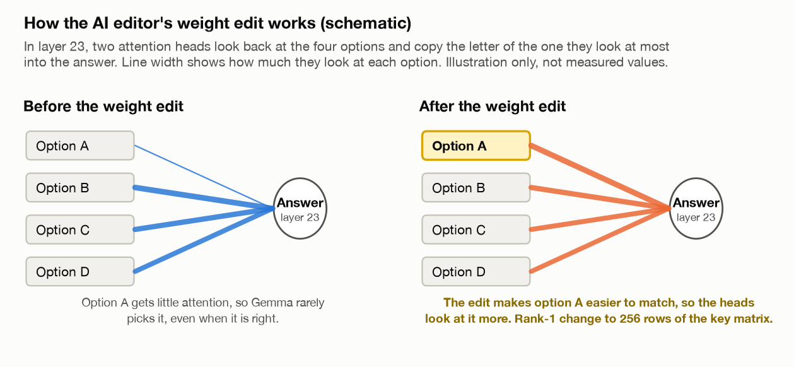
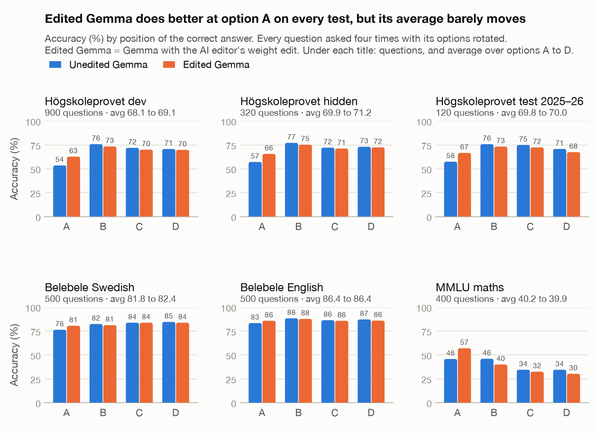
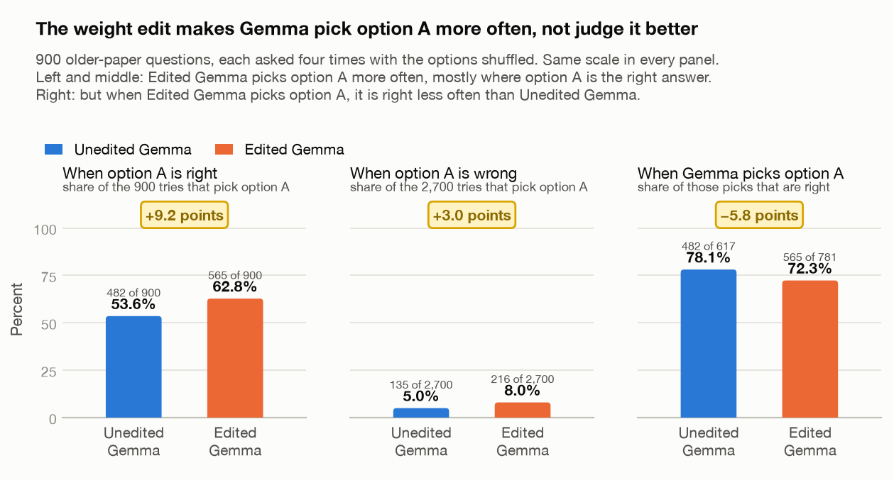
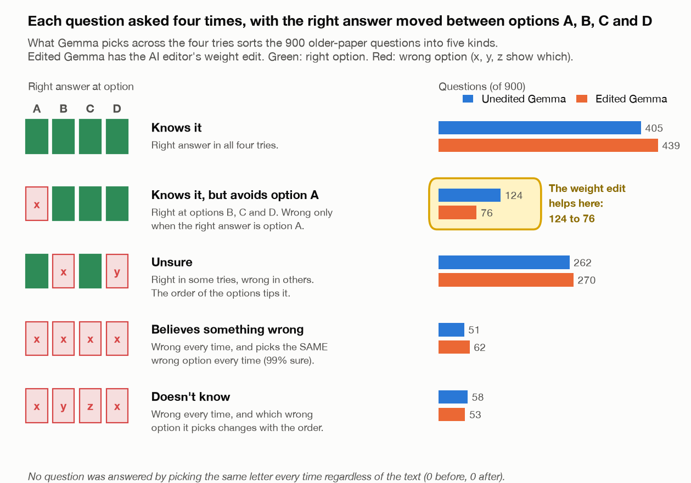
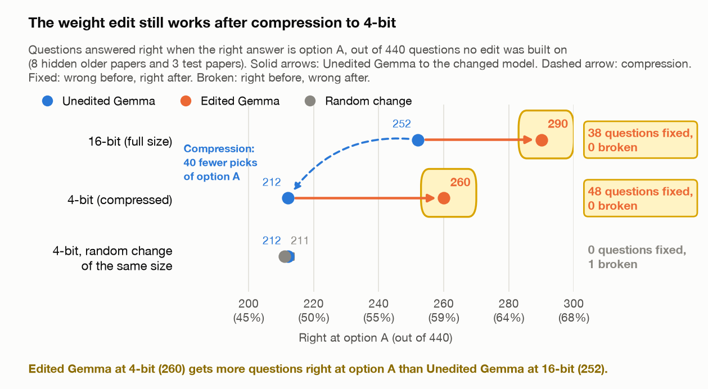

# Can a targeted weight edit improve a model's Swedish? A test on Gemma 3 4B

**Summary.** I tested whether small, targeted changes to a model's weights can make it better at Swedish, using Gemma 3 4B and Högskoleprovet, the Swedish university entrance exam. In my tests, they did not. A weight edit found by an AI agent reduced a real habit (Gemma avoids answer option A), and that fix survives compression to 4-bit. But I found no sign that any weight edit changed which answers Gemma can reach. Other research points to training instead, mainly distillation: training the Swedish model on a stronger model's outputs. I did not test training myself.

## 1. The article

[_Sparks of Weight-Space Programming_](https://rikiyat.github.io/blog/weight-space-programming/) (Takehi et al., 2026) is a blog post, not peer reviewed. It claims that an AI agent can read and edit the weights of another neural network.

- **What it shows:** the agent Astra changed 0.016% of a small model's weights (Qwen3.5-0.8B), and its maths score (MATH-500) rose from 7.9% to 48.1%. An [independent re-run](https://huggingface.co/JonathanColetti/Qwen3.5-0.8B-Astra-WeightEdit) got a similar result (7.4% to 50.2%).
- **What it does not show: better maths.** With thinking on, the model got stuck repeating itself and _"rarely reaches an answer"_. With thinking off, the unedited model already solved 45.8%, and the edit made it slightly worse (−2.2 points). The re-run: _"This removes a failure mode; it doesn't add capability."_ The authors: _"Editing weights could remove an obstacle that hid an ability, but it could not add an ability the model lacked."_
- **Reading weights alone worked on small networks** (games, a tiny image generator, three tiny language models), **but failed on a larger language model** (Gemma 3 270M): _"from the weights alone, Astra was unable to tell"_ which copy was sycophantic.
- **The maths edit needed feedback:** Astra used the model's answers to practice problems, and the big gain came only with the largest budget of 50 rounds.
- **For Swedish:** when a model gets Swedish wrong, is a habit hiding what it knows, or does it not know? The article suggests a weight edit can only help in the first case.

## 2. Hypothesis

**My hypothesis:** if I change Gemma's weights using its mistakes on the older exam papers, the edited model will do better on the newest, unseen exam papers, and the gain will survive compression.

I tried three ways to build such a weight edit: one edit per wrong question, one group edit trained on many wrong answers at once, and AI editors. The AI editors were added after the first two. All three are judged by the same rule, fixed before any model was run ([`config/decision.toml`](config/decision.toml), committed to git on 19 November at 01:03, about six hours before the first run. One later line limits the score to the reading and sentence-completion sections).

- **Why it matters:** Swedish training is expensive (AI Sweden's Llama 3 8B took 92 GPUs for 30 days, [model card](https://huggingface.co/AI-Sweden-Models/Llama-3-8B)), while a weight edit takes seconds (about 4 seconds for ROME, [Meng et al., ICLR 2023](https://arxiv.org/abs/2210.07229)). Models are often compressed to 4-bit ([Google, 2025](https://developers.googleblog.com/en/gemma-3-quantized-aware-trained-state-of-the-art-ai-to-consumer-gpus/)), and compression can undo small weight changes ([Zhang et al., ICLR 2025](https://arxiv.org/abs/2410.16454)).
- **How I test it:** the reading (LÄS) and sentence-completion (MEK) sections of Högskoleprovet, the Swedish university entrance exam. Multiple choice, four options. The model's answer is the option it finds most likely. Edits are judged on the 3 newest papers (2025–26, 120 questions), published after Gemma was trained.
- **What would support it** (the pre-set rule): more probability on the right answers with a 95% interval above zero, better than a random weight change of the same size, no damage to ordinary Swedish text, and the gain kept at 4-bit.
- **What would challenge it:** the weight edit only fixes the questions it was built on, a random change does as well, the model gets worse elsewhere, it just picks one option more often, or it loses its gain at 4-bit.

## 3. Experiment

I used two open models, Qwen3.5-9B and Gemma 3 4B. I ran each one at full precision (16-bit, bfloat16) and compressed to 4-bit by me with llama.cpp (format Q4_K_M: most weights stored in 4 bits, a few weight matrices in 6 bits). I built and tuned every weight edit on the 23 older exam papers, and kept the 3 newest papers, after the model's knowledge cutoff for the final test. I worked in steps, and each step decided the next one:

1. **Baselines.** I ran all four model versions (2 models × 16-bit and 4-bit) on the 23 older papers and the 3 test papers.
2. **One weight edit per wrong question, on both models.** For up to 10 questions each model got wrong, I made the smallest change, from a fixed set of sizes, to one weight matrix (a rank-1 change in one layer, about two-thirds of the way up the model) that made the model answer that question correctly. Each weight edit had a random control: a random change of the same size in the same layer.
3. **Focus on Gemma.** Gemma had much more room to improve than Qwen, and it lost more accuracy when compressed from 16-bit to 4-bit. So all later steps used Gemma only.
4. **One group edit on Gemma.** Instead of one question at a time, I trained one small low-rank change on 205 wrong answers at once. This is a standard fine-tuning method. I stopped training using 3 separate validation papers and tested on 8 older papers that training never saw.
5. **AI editors on Gemma, the article's method.** Three Claude Opus 5.5 AI agents each got Gemma's 16-bit weights and 870 practice questions with answers. Each also got a budget of model runs, like Astra in the article: 10, 25 or 50 runs. I name them by that budget: the *10-run*, *25-run* and *50-run AI editor*. They could not use gradients (they could not train the model). Each could hand in one weight edit. They used only 5, 7 and 11 of their runs.
6. **Testing the best AI-editor weight edit.**
   - **Which weight edit.** Each AI editor made and tested several weight edits while it worked. At the end, each had to give one final weight edit as its answer. All three chose to give no change as their final answer, because every weight edit they had tried fixed about as many questions as it broke. Four of the weight edits they had tried were saved. I scored all four on the unseen papers and picked the best one, made by the 50-run AI editor. Because I picked it after seeing its results on unseen papers, those results are not fully independent.
   - **The four-order test.** To see whether Gemma's mistakes depend on where the right answer is placed, I asked every question four times. Each time I moved every option one place down, so the right answer was shown once as option A, once as option B, once as option C and once as option D. This test was not in my original plan. I added it after the AI editors found Gemma's habit, so it is exploratory.
   - **Two simple fixes that change no weights,** to compare with the weight edit:
     - *A note in the prompt:* one extra sentence telling Gemma that the options are in random order, and to read all of them carefully, including the first.
     - *Averaging over the four orders:* ask each question in all four orders, add up how likely Gemma finds each option across the four tries, and choose the option with the highest total. Each option sits at option A exactly once, so the habit of avoiding option A affects every option equally and cancels out.
7. **Checks.** I compressed the edited Gemma from 16-bit to 4-bit. I tested the edited Gemma on two other exams: Belebele (reading, in Swedish and English) and MMLU (maths). Nine independent AI agents re-checked about 120 of my numbers.

**How much of the model the AI weight edits changed:**

| Weight edit | What it changes | Numbers that define the edit | Weights touched | Weights changed | Share of the model |
|---|---|---|---|---|---|
| Astra's maths edit (from the article, Qwen3.5-0.8B) | 64 columns in each of 2 matrices | not given | 131,072 | 131,072 | 0.016% |
| My AI editor's weight edit (Claude Opus 5.5, Gemma 3 4B) | 256 rows × 2,560 columns of 1 matrix (layer 23) | 256 + 2,560 = 2,816 | 256 × 2,560 = 655,360 | 366,231 | 0.0085% |

**How to read the table.** A rank-1 change is defined by two short lists of numbers: one per row (256) and one per column (2,560). Each weight changes by its row number times its column number, so all 655,360 weights in the block are touched. Stored in 16-bit format, many tiny changes round away, leaving 366,231 really changed. Share: 366,231 ÷ 4,300,079,472 = 0.0085%, about half the size of Astra's edit.

## 4. Results

All scores are on the reading and sentence-completion questions (LÄS + MEK).

**Baselines.** On the 3 test papers (120 questions), Qwen got 93.3% right at 16-bit and 90.8% at 4-bit. Gemma got 70.0% at 16-bit and 65.8% at 4-bit.

**Earlier steps, in short:**

- **One weight edit per wrong question did not generalise.** Each fixed only its own question. None of the 12 improved the test papers, and 9 made them worse.
- **The group edit (fine-tuning on 205 wrong answers) gave no real gain:** 5 unseen questions fixed and 4 broken, within chance.
- **The AI editors' weight edit (below) also failed the pre-set rule** on the test papers. So no weight edit built on the older papers made Gemma better on the unseen papers, and the answer to my hypothesis is no.

The rest of this section is about the AI editors' weight edit.

**Background: layers and the AI editors.**

- **Layers.** Gemma 3 4B reads a question in 34 layers, one after another. Each layer refines what the model has worked out so far. Inside each layer, *attention heads* let each word look back at earlier words and take information from them. Each layer's weights are large tables of numbers. One of them, the "key" table of layer 23, has 1,024 × 2,560 numbers.
- **The AI editors.** Three AI agents (Claude Opus 5.5) each got Gemma's weights, 870 practice questions with their answers, and a budget of 10, 25 or 50 model runs. A run could answer practice questions or show Gemma's internal activity, for example which words an attention head looks at. The AI editors could not train the model with gradients. Each could hand in one weight edit. This copies the article's maths experiment. They used only 5, 7 and 11 of their runs.

**What the AI editors found: Gemma avoids option A.** Every reading and sentence-completion question has four options, option A to option D. For 124 of the 900 older-paper questions, Gemma was right when the right answer was at option B, C or D, but wrong when it was at option A. This is a known multiple-choice bias: language models favour or avoid particular option letters ([Zheng et al., ICLR 2024](https://arxiv.org/abs/2309.03882)). It also shows in English, but about twice as strongly in Swedish: on the same Belebele questions, 31 Swedish and 15 English questions were wrong only at option A.

**Where the habit sits.** The 50-run AI editor traced it to layer 23, where Gemma settles on its answer letter. Two attention heads there look back at the end of each option and copy that option's letter into the answer. They give option A the least attention. Gemma reads the options in order, so it judges option A before it has seen the others.

**What the weight edit does.** The 50-run AI editor's weight edit adds a small fixed change to the part of layer 23 that decides how much these two heads look at each option: 256 rows of the key table, a rank-1 change. After the edit, the two heads look at option A more, on every question. It works like turning up the volume on option A. It does not make Gemma judge option A any better. The AI editor found this by running the model and watching its internal activity, not from the weights alone.

**Why no AI editor chose a weight edit as its final answer.** Each weight edit they tried fixed about as many questions as it broke. The 50-run AI editor wrote that a real fix would require the model *"to re-evaluate the first option after reading the others, i.e. adding an ability, not removing an obstacle."* I tested its best weight edit anyway.

{width=66%}

**The AI editor's best weight edit: the habit is real, the knowledge did not change.** Every question was asked four times, with the right answer at option A, B, C and D in turn (older papers, 900 questions):

Right answers out of 900 at each position (out of 3,600 for all four):

| Right answer placed at | Option A | Option B | Option C | Option D | All four |
|---|---|---|---|---|---|
| Unedited Gemma | 482 (53.6%) | 683 (75.9%) | 648 (72.0%) | 637 (70.8%) | 2,450 (68.1%) |
| Edited Gemma | 565 (62.8%) | 661 (73.4%) | 631 (70.1%) | 629 (69.9%) | 2,486 (69.1%) |

**The six tests in Figure 1.** Högskoleprovet *dev*: all 900 questions from the 23 older papers (the AI editors practised on some of them). *Hidden*: 320 questions from 8 older papers no edit was built on. *Test*: 120 questions from the 3 newest papers. *Belebele* Swedish and English: the same 500 reading questions in both languages, to check whether the habit is about Swedish. *MMLU maths*: 400 maths questions, to check other subjects.

{width=66%}
_Figure 1. Unedited Gemma (blue) and Edited Gemma (orange) on every test. Accuracy at option A rises on every test, but the average over options A to D barely changes._

- **The weight edit reduced the habit, but did not remove it.** With the right answer at option A, it turned 83 wrong answers right and turned no right answers wrong. It cut the 124 questions Gemma got wrong only at option A to 76. On unseen papers it did the same: 27 gained and 0 lost on the 8 held-out older papers, and 11 gained and 0 lost on the test papers. A random change of the same size gained 2. But by the rule I fixed before any edit, this weight edit is still "no improvement" on the test papers (change +0.009, 95% interval −0.016 to +0.038).
- **It did not add knowledge.** It lost some answers at options B, C and D, so the average over all four positions rose by only 1 point (more detail below).
- **Two fixes that change no weights did as well.** On the test papers: unedited 70.0%, note in the prompt 73.3%, averaging over the four orders 75.0%, weight edit 70.8%. On the hidden papers averaging also matched the weight edit (74.4% against 73.8%), but the prompt note did not help (71.9% against 72.5% unedited). None of these differences is statistically clear (exact tests, p ≥ 0.125).
- **The same on other exams.** Answers at option A improved on Belebele Swedish (21 gained, 0 lost), Belebele English (12 and 0) and MMLU maths (45 and 0). The average over positions did not change: Swedish 81.8% → 82.4%, English 86.4% → 86.4%, maths 40.2% → 39.9%. On maths, where Gemma already favoured option A, the weight edit raised how often it picked option A to 39% of answers.

**The weight edit makes Gemma pick option A more often, not judge it better or make it smarter at Swedish** I counted how often Gemma picks option A, as a share of the tries (Figure 2):

- **When option A is right**, Edited Gemma picks it in 62.8% of tries, up from 53.6% (+9.2 points).
- **When option A is wrong**, Edited Gemma picks it in 8.0% of tries, up from 5.0% (+3.0 points).
- **When Gemma picks option A**, that pick is right 72.3% of the time, down from 78.1%.

The extra picks land mostly where Gemma already knew the answer, so a small push toward option A flipped them. But the picks of option A became less reliable, also on the test papers (77.5% → 72.1%) and at 4-bit (78.8% → 73.0%). A better judge of option A would have made them more reliable.

{width=66%}
_Figure 2. How often Gemma picks option A when it is right (left) and when it is wrong (middle), and how often a pick of option A is right (right)._

**What Gemma picks: five kinds of questions.** To tell a bad habit apart from missing knowledge, I looked at which option Gemma picks in each of the four tries. Think of Gemma as a student who sees the same question four times, with the options shuffled (Figure 3):

{width=66%}
_Figure 3. The 900 older-paper questions, sorted by what Gemma picks across the four tries, before and after the AI editor's weight edit._

1. **Knows it.** Gemma picks the right answer every time.
2. **Knows it, but avoids option A.** Gemma picks the right answer when it is at option B, C or D, but not when it is at option A.
3. **Unsure.** Sometimes right, sometimes wrong. The order of the options tips it.
4. **Believes something wrong.** Gemma picks the same wrong answer every time, and is 99% sure of it.
5. **Doesn't know.** Always wrong, and which wrong answer it picks changes with the order.

Gemma never picked the same letter every time without reading the options. It always picks by content, even when the content it picks is wrong.

What the weight edit changed:

- **It helped some of the "avoids option A" questions.** For 45 of the 124, the edited Gemma now picks the right answer at option A as well. Of the other 79, 73 stayed the same and 6 became "unsure".
- **It did not make Gemma know more.** None of the 109 questions in kinds 4 and 5 became a question Gemma knows. 12 became right in some orders, but 18 others joined, so kinds 4 and 5 grew to 115. These questions are answerable: Qwen 9B got 68 of the 109 right.
- **It kept its wrong answers.** When the edited Gemma was still wrong at option A, it picked exactly the same wrong answer as before on 329 of 335 questions. On the unseen papers it was 110 of 110 (hidden) and 40 of 40 (test).

**Two examples** (short quotations from Högskoleprovet, UHR. Translations are mine.)

- **Fixed by the weight edit** (2022-10-23, provpass 5, MEK 22, a hidden paper): *"Lyssnandets _____ är att du förstår en annan människa sämre ju mer uppmärksamt du lyssnar på henne."* ("The _____ of listening is that you understand another person worse the more attentively you listen to her.") Options: analogi, kontrast, paradox, distinktion. Right answer: paradox. Unedited Gemma picks "paradox" when it is option B, C or D, but picks "distinktion" when "paradox" is option A. Edited Gemma picks "paradox" as option A too, with 99.8% probability.
- **A wrong belief the weight edit did not change** (2020-10-25, provpass 2, MEK 22, a hidden paper): *"Det arrangeras ett särskilt spåranlagsprov för blodhundar, där hundens förmåga att följa även mycket svag _____ av människa bedöms."* ("A special tracking test is arranged for bloodhounds, in which the dog's ability to follow even a very faint _____ of a person is assessed.") Options: vittring (scent), impuls, prägling, indikation. Right answer: vittring. Gemma picks "indikation" in all four orders with about 100% probability, before and after the weight edit.

**After compression from 16-bit to 4-bit** (exploratory, like the four-order test). I compressed unedited Gemma, edited Gemma and Gemma with a random change of the same size to 4-bit in the same way, and asked every question in all four orders again.

{width=66%}
_Figure 4. Questions answered right when the right answer is option A, out of the 440 questions no edit was built on (8 hidden older papers and 3 test papers). Each arrow goes from Unedited Gemma to Edited Gemma, or to Gemma with a random change of the same size._

- **Compression makes the option-A habit worse.** Compression costs Unedited Gemma some accuracy overall, but most at option A. On the 440 unseen questions, right answers at option A drop from 252 to 212 (−40). At options B, C and D the changes are −9, +17 and −25. The questions Gemma gets wrong only at option A rise from 53 to 82.
- **The weight edit still works at 4-bit.** At option A it fixed 48 questions and broke none at 4-bit, against 38 fixed and none broken at 16-bit. The random change of the same size fixed 0 and broke 1. (Fixed: wrong before, right after. Broken: right before, wrong after.) Edited Gemma at 4-bit even gets more questions right at option A (260) than Unedited Gemma at 16-bit (252).
- **The weight edit itself survives the rounding.** Only the 256 edited rows of one matrix differ between the two 4-bit files, and 86% of the changed weights (314,961 of 366,231) are still different after 4-bit.

**Damage.** The AI editor's weight edit passed my damage check: perplexity on ordinary Swedish text rose by less than 5%.

## 5. Interpretation: what I learned

1. **My hypothesis was wrong.** No weight edit built on the older papers improved the unseen test papers by my pre-set rule: not the one-question edits (9 of 12 made them worse), not the group edit, and not the AI editors' weight edit.
2. **What a weight edit can do: change a behaviour.** The AI editor's weight edit reduced Gemma's habit of avoiding option A, on unseen papers, on other exams and after compression. A random change of the same size did nothing.
3. **What it did not do: change which answers Gemma can reach.** None of the 109 questions Gemma always got wrong became right in all four orders, and that group grew to 115. When Edited Gemma was still wrong at option A, it gave the same wrong answer as before on 329 of 335 questions. Its picks of option A became less reliable (78.1% → 72.3% right). Averaging over the four orders, which changes no weights, did as well as the weight edit.
4. **This matches the article and the wider research.** The article's own success also removed a behaviour (looping). A tiny edit to Gemma 7B's weights switched off its refusals without changing its knowledge score ([Arditi et al., NeurIPS 2024](https://arxiv.org/abs/2406.11717)), and edits to "language neurons" did not improve tasks in low-resource languages ([Mondal et al., 2025](https://aclanthology.org/2025.insights-1.6/)).

**Main conclusion.** Changing Gemma's weights changed how it picks among answers it can already reach. I found no sign that it changed which answers Gemma can reach. Most of Gemma's mistakes depend on the order of the options (386 of 900 questions), and 109 questions are wrong in every order. The weight edit helped some of the first kind and none of the second. I did not test training, so whether training closes the gap is what other research suggests, not something I showed. I found no small weight edit that changes which answers a model can reach in Swedish, and I found no published work that shows one.

## 6. Recommendation for SE.LLMA

**Do not use weight edits to make a model better at Swedish.** In my tests they only changed how Gemma picks among answers. The routes below come from other research, not from my experiment:

1. **Main route: distillation during pre-training.** The Swedish model reads large amounts of Swedish text and learns from a stronger teacher model's predictions. Google trained its small Gemma 2 models this way, and they *"offer competitive alternatives to models that are 2-3 times bigger"* ([Gemma Team, 2024](https://arxiv.org/abs/2408.00118)). Mix older data back in to prevent forgetting ([Borggren et al., EMNLP 2026](https://arxiv.org/abs/2608.30609), [Ibrahim et al., TMLR 2024](https://arxiv.org/abs/2403.08763)).
2. **Then distillation during post-training, for behaviour.** Fine-tune on Swedish answers written by a stronger model. It improves fluency (win rates up to +56.5%, [Odumakinde et al., ACL 2025](https://arxiv.org/abs/2408.14960)), not knowledge (MMLU 29.8 → 30.1, [Lai et al., EMNLP 2023](https://aclanthology.org/2023.emnlp-demo.28/)). It is cheap: about 860 GPU hours for an 8B model (my sum of the stages in [Lambert et al., COLM 2025](https://arxiv.org/abs/2411.15124)).
3. **Start from the strongest multilingual model.** On the Swedish sections of Högskoleprovet, AI Sweden's Llama 3 8B, trained further on Nordic text, scored about the same as the original (62.4% against 63.0%), while Gemma 2 9B scored 84.8% ([Kurfalı et al., 2025](https://aclanthology.org/2025.nodalida-1.36/), my averages of the three sections).
4. **A strong model that thinks in English, with a separate model writing the Swedish, helps on maths only** (54.5% against 45.6%, [Bu and Feng, ACL 2026](https://arxiv.org/abs/2603.17512)). Tasks that test Swedish itself cannot be translated without removing what they test.

**Next experiment:** distil a strong teacher into Gemma 3 4B on Swedish text, then rerun my four-order test. It should shrink the group of questions Gemma always gets wrong, which the weight edit did not (109 before, 115 after). No study has yet tested distillation for Swedish.

## 7. Limitations

- **One model and one exam format:** Gemma 3 4B, multiple choice with four options, answers read as the most likely option letter.
- **Small unseen test sets:** 120 and 320 questions. A gain of a few points could go undetected.
- **Each setup was run once.** Scoring is repeatable (three runs agreed on all 3,600 answers), but the random controls, the group-edit training, the AI editors and the prompt wording were run only once.
- **Exploratory parts:** the four-order test, the five kinds and the compression measure were added after I saw the habit. I chose the AI editor's weight edit using its results on the unseen papers. By my pre-set rule it is "no improvement".
- **"Knows it" is measured indirectly,** from the four orders.
- **No positive control:** I never showed that training adds knowledge in my own setup.
- **The AI editors stopped early:** they used 5, 7 and 11 of their 10, 25 and 50 runs.
- **Other limits:** Gemma may have seen the older papers in training. Qwen's cutoff is not published. The looping check was too noisy. I tested one compression format (Q4_K_M). The run files do not record my code version.
- **The recommendation is not tested by me.** No cited study tests distillation for Swedish. Two cited studies are preprints.

## 8. AI usage

- **Claude Code with Claude Opus 5.5** wrote the test bench, helped run the experiments on a rented GPU machine, analysed the results, made the figures and drafted this report. I made the decisions (the question, the models, the exam, the focus on Gemma, the conclusion) and reviewed every section.
- **Three Claude Opus 5.5 agents were the AI editors** in step 5, under fixed rules: no gradients, a budget of model runs, no access to the test papers.
- **Separate AI agents checked the work.** Nine agents recomputed about 120 numbers from the raw files ([`verification/SUMMARY.md`](verification/SUMMARY.md)). Later agents re-checked the new numbers, every citation and the claims. AI research agents found and quoted the sources.
- **Swedish.** I do not read Swedish. An AI agent translated the two example questions.
- **Time.** About 4 hours of my own time. I monitored the benchmarks and ran the evaluations. AI agents did much of the coding, the checks and the literature search, partly unattended.

## References

\begingroup\small

Peer-reviewed papers are listed with their venue. Two papers are preprints and are marked "(preprint)". Blog posts, model cards, software and web pages are marked as such.

- Adelani, D. I., Ojo, J., Azime, I. A., Zhuang, J. Y., et al. (2025). IrokoBench: A New Benchmark for African Languages in the Age of Large Language Models. NAACL 2025. <https://arxiv.org/abs/2406.03368>
- AI Sweden (2024). AI-Sweden-Models/Llama-3-8B. Model card, Hugging Face. <https://huggingface.co/AI-Sweden-Models/Llama-3-8B>
- Arditi, Obeso, Syed, Paleka, Panickssery, Gurnee, Nanda (2024). Refusal in Language Models Is Mediated by a Single Direction. NeurIPS 2024. <https://arxiv.org/abs/2406.11717>
- Bandarkar, L., Liang, D., Muller, B., Artetxe, M., Shukla, S. N., Husa, D., Goyal, N., Krishnan, A., Zettlemoyer, L., Khabsa, M. (2024). The Belebele Benchmark: a Parallel Reading Comprehension Dataset in 122 Language Variants. ACL 2024. <https://aclanthology.org/2024.acl-long.44/>
- Borggren, L., Kunz, J., Kuhlmann, M. (2026). Reading the News: Adapting Large Language Models to Swedish Journalism Through Continued Pre-Training. EMNLP 2026 Industry Track. <https://arxiv.org/abs/2608.30609>
- Bu, M., Feng, Y. (2026). Language on Demand, Knowledge at Core: Composing LLMs with Encoder-Decoder Translation Models for Extensible Multilinguality. ACL 2026. <https://arxiv.org/abs/2603.17512>
- Dang et al. (2024). Aya Expanse: Combining Research Breakthroughs for a New Multilingual Frontier. arXiv:2412.04261 (preprint). <https://arxiv.org/abs/2412.04261>
- Gemma Team (2024). Gemma 2: Improving Open Language Models at a Practical Size. arXiv:2408.00118 (preprint). <https://arxiv.org/abs/2408.00118>
- Google (2025). google/gemma-3-4b-it. Model card, Hugging Face. <https://huggingface.co/google/gemma-3-4b-it>
- Google (2025). Gemma 3 QAT Models: Bringing state-of-the-Art AI to consumer GPUs. Blog post, Google Developers Blog, 18 April 2025. <https://developers.googleblog.com/en/gemma-3-quantized-aware-trained-state-of-the-art-ai-to-consumer-gpus/>
- Hendrycks, D., Burns, C., Basart, S., Zou, A., Mazeika, M., Song, D., Steinhardt, J. (2021). Measuring Massive Multitask Language Understanding (MMLU). ICLR 2021. <https://arxiv.org/abs/2009.03300>
- Ibrahim, A., Thérien, B., Gupta, K., Richter, M. L., Anthony, Q., Lesort, T., Belilovsky, E., Rish, I. (2024). Simple and Scalable Strategies to Continually Pre-train Large Language Models. Transactions on Machine Learning Research (TMLR), 2024. <https://arxiv.org/abs/2403.08763>
- JonathanColetti (2026). Qwen3.5-0.8B-Astra-WeightEdit. Model card with an independent re-run, Hugging Face. <https://huggingface.co/JonathanColetti/Qwen3.5-0.8B-Astra-WeightEdit>
- Kunz, J. (2026). A Diagnostic Benchmark for Sweden-Related Factual Knowledge. LREC 2026. <https://aclanthology.org/2026.lrec-1.416/>
- Kunz, Jarochenko, Bollmann (2026). A Dataset for Probing Translationese Preferences in English-to-Swedish Translation. LREC 2026. <https://aclanthology.org/2026.lrec-1.690/>
- Kurfalı, M., Zahra, S., Gogoulou, E., Dürlich, L., Carlsson, F., Nivre, J. (2025). SweSAT-1.0: The Swedish University Entrance Exam as a Benchmark for Large Language Models. NoDaLiDa/Baltic-HLT 2025. <https://aclanthology.org/2025.nodalida-1.36/>
- Lai, V., Nguyen, C., Ngo, N., Nguyen, T., Dernoncourt, F., Rossi, R., Nguyen, T. (2023). Okapi: Instruction-tuned Large Language Models in Multiple Languages with Reinforcement Learning from Human Feedback. EMNLP 2023 System Demonstrations. <https://aclanthology.org/2023.emnlp-demo.28/>
- Lambert, N., Morrison, J., Pyatkin, V., et al. (2025). Tülu 3: Pushing Frontiers in Open Language Model Post-Training. COLM 2025. <https://arxiv.org/abs/2411.15124>
- Liu, Zhang, Zhao, Luu, Bing (2025). Is Translation All You Need? A Study on Solving Multilingual Tasks with Large Language Models. NAACL 2025. <https://arxiv.org/abs/2403.10258>
- llama.cpp (ggml-org). Software for running and compressing language models. Software, GitHub. <https://github.com/ggml-org/llama.cpp>
- Meng, K., Bau, D., Andonian, A., Belinkov, Y. (2022). Locating and Editing Factual Associations in GPT (ROME). NeurIPS 2022. <https://arxiv.org/abs/2202.05262>
- Meng, Sen Sharma, Andonian, Belinkov, Bau (2023). Mass-Editing Memory in a Transformer (MEMIT). ICLR 2023. <https://arxiv.org/abs/2210.07229>
- Mondal, Sen, Singhania, Jyothi (2025). Language-Specific Neurons Do Not Facilitate Cross-Lingual Transfer. Sixth Workshop on Insights from Negative Results in NLP, 2025. <https://aclanthology.org/2025.insights-1.6/>
- Odumakinde, D'souza, Verga, Ermis, Hooker (2025). Multilingual Arbitration: Optimizing Data Pools to Accelerate Multilingual Progress. ACL 2025. <https://aclanthology.org/2025.acl-long.939/>
- Ollama. gemma3 tags. Web page (model library listing). <https://ollama.com/library/gemma3/tags>
- Qwen Team (2026). Qwen/Qwen3.5-9B. Model card, Hugging Face. <https://huggingface.co/Qwen/Qwen3.5-9B>
- Samuel, D., Øvrelid, L., Velldal, E., Kutuzov, A. (2026). Fluent Alignment with Disfluent Judges: Post-training for Lower-resource Languages. ICLR 2026. <https://arxiv.org/abs/2512.08777>
- Shi, Suzgun, Freitag, Wang, Srivats, Vosoughi, Chung, Tay, Ruder, Zhou, Das, Wei (2023). Language Models are Multilingual Chain-of-Thought Reasoners. ICLR 2023. <https://arxiv.org/abs/2210.03057>
- Takehi, R., Teoh, J., Zhang, A., Khattab, O. (2026). Sparks of Weight-Space Programming: LLMs can natively read & write neural network weights. Blog post, 2 November 2026, not peer reviewed. <https://rikiyat.github.io/blog/weight-space-programming/>
- Tang, Luo, Huang, Zhang, Wang, Zhao, Wei, Wen (2024). Language-Specific Neurons: The Key to Multilingual Capabilities in Large Language Models. ACL 2024. <https://aclanthology.org/2024.acl-long.309/>
- UHR (Universitets- och högskolerådet). Högskoleprovet: past exam booklets and answer keys. Web page, studera.nu. <https://www.studera.nu/hogskoleprov/om/forbereda/tidigare/>
- Wang, X., Hu, C., Ma, B., Röttger, P., Plank, B. (2024). Look at the Text: Instruction-Tuned Language Models are More Robust Multiple Choice Selectors than You Think. COLM 2024. <https://arxiv.org/abs/2404.08382>
- Zhang, Müller-Eberstein, Bassignana, van der Goot (2025). SnakModel: Lessons Learned from Training an Open Danish Large Language Model. NoDaLiDa/Baltic-HLT 2025. <https://aclanthology.org/2025.nodalida-1.80/>
- Zhang, Z., Wang, F., Li, X., Wu, Z., Tang, X., Liu, H., He, Q., Yin, W., Wang, S. (2025). Catastrophic Failure of LLM Unlearning via Quantization. ICLR 2025. <https://arxiv.org/abs/2410.16454>
- Zheng, C., Zhou, H., Meng, F., Zhou, J., Huang, M. (2024). Large Language Models Are Not Robust Multiple Choice Selectors. ICLR 2024. <https://arxiv.org/abs/2309.03882>

\endgroup
